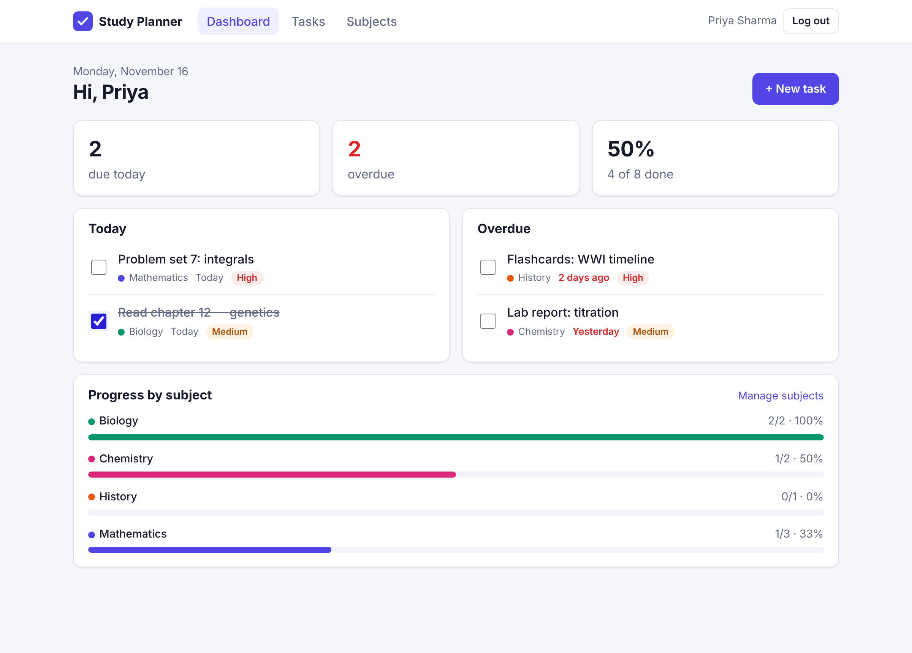
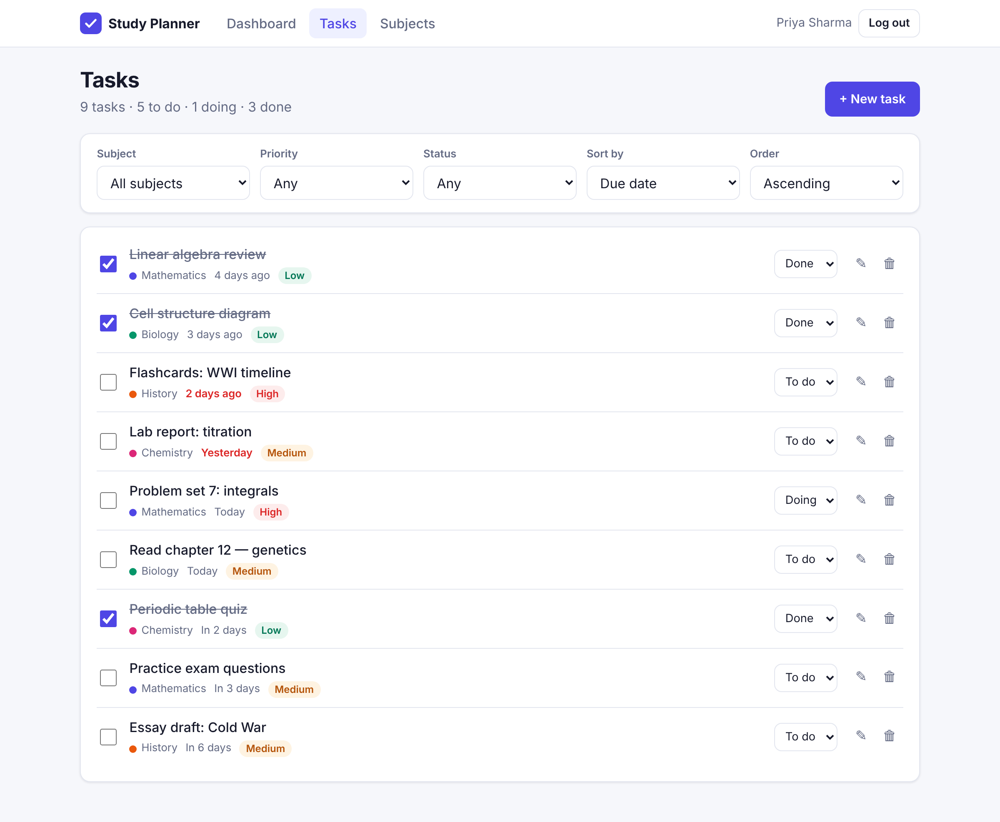
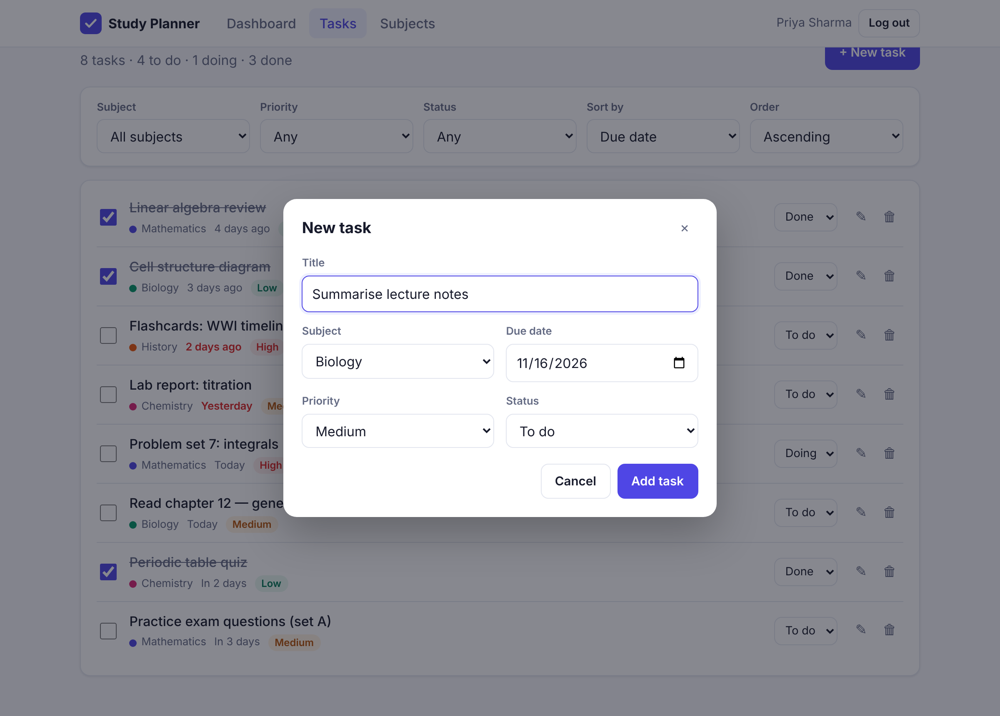
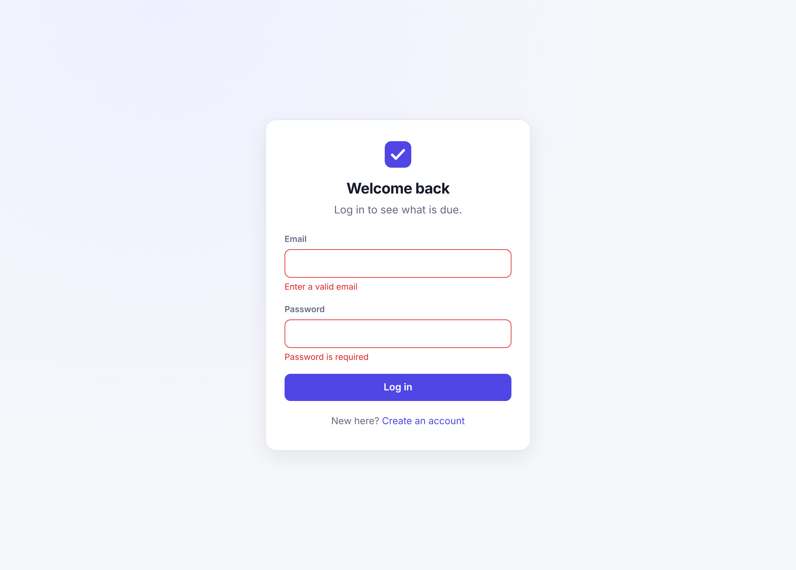
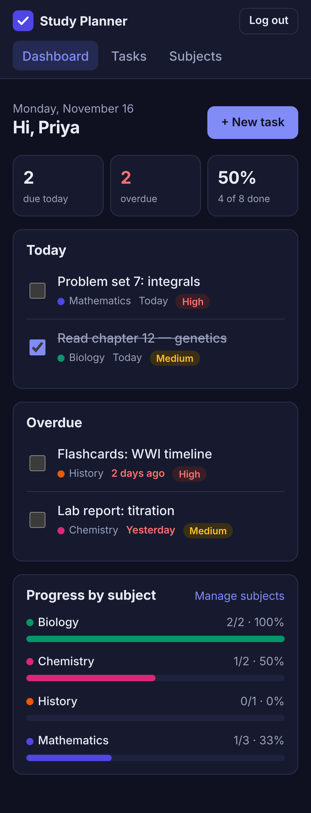

# Study Planner

A full-stack study planner: organise coursework into subjects, track tasks by due date, priority and status, and see at a glance what's due today, what's overdue, and how far along each subject is.



## Features

- **Accounts** — register, log in and log out. Sessions use a JWT stored in an `httpOnly` cookie, so JavaScript in the page never sees the token.
- **Private data** — every subject and task is scoped to its owner. Other users' records return `404`, and you can't attach a task to someone else's subject.
- **Subjects** — create, rename, recolour and delete. Deleting a subject also deletes its tasks, after you confirm.
- **Tasks** — full CRUD with title, subject, due date, priority (`low` / `medium` / `high`) and status (`todo` / `doing` / `done`). Tick the checkbox for a quick done/undo, or change status inline.
- **Dashboard** — tasks due today, overdue tasks (anything not done whose date has passed), overall completion, and a progress bar per subject.
- **Filter & sort** — filter by subject, priority and status. Sort by due date, priority (high → low is logical, not alphabetical), title or date added, ascending or descending. Filters live in the URL, so a filtered view can be bookmarked.
- **Validation everywhere** — the client validates forms for fast feedback, and the server validates every body, query and route parameter with `express-validator`. Server field errors appear next to the matching inputs.
- **Responsive UI** — plain CSS. Works from phone to desktop and follows the system light/dark setting.

## Tech stack

| Layer    | Tech |
|----------|------|
| Frontend | React 19, Vite, React Router, plain CSS |
| Backend  | Node.js, Express 5, express-validator, helmet, cors, cookie-parser |
| Database | MongoDB with Mongoose 8 |
| Auth     | JWT (`jsonwebtoken`) in an `httpOnly` cookie, passwords hashed with `bcrypt` (12 rounds) |
| Tests    | Jest + Supertest against an in-memory MongoDB (`mongodb-memory-server`) |

## Project structure

```
study-planner/
├── client/                 React app (Vite)
│   ├── src/
│   │   ├── components/     Layout, TaskForm, TaskItem, Modal, ProgressBar, Field
│   │   ├── context/        AuthContext (current user, login/register/logout)
│   │   ├── lib/            api client, date helpers, useAsync hook
│   │   └── pages/          Dashboard, Tasks, Subjects, Login, Register
│   ├── vercel.json         SPA fallback + /api proxy to Render
│   └── .env.example
├── server/                 Express API
│   ├── src/
│   │   ├── controllers/    auth, subjects, tasks, dashboard
│   │   ├── middleware/     auth (JWT), validators, validate, error handler
│   │   ├── models/         User, Subject, Task
│   │   ├── routes/
│   │   ├── utils/
│   │   ├── app.js          Express app (imported by the tests)
│   │   └── index.js        Connects to MongoDB and starts the server
│   ├── tests/api.test.js
│   └── .env.example
└── docs/screenshots/
```

## API

Base URL: `/api`. All request and response bodies are JSON. Routes marked 🔒 need the auth cookie and return `401` without a valid one.

| Method | Endpoint | Auth | Description |
|--------|----------|------|-------------|
| GET    | `/health` | – | Health check |
| POST   | `/auth/register` | – | Body `{ name, email, password }`. Creates the account and sets the cookie. `201`, or `409` if the email is taken |
| POST   | `/auth/login` | – | Body `{ email, password }`. Sets the cookie. `401` on bad credentials |
| POST   | `/auth/logout` | – | Clears the cookie. `204` |
| GET    | `/auth/me` | 🔒 | The current user |
| GET    | `/subjects` | 🔒 | List your subjects |
| POST   | `/subjects` | 🔒 | Body `{ name, color? }`. `409` if the name already exists (case-insensitive) |
| PATCH  | `/subjects/:id` | 🔒 | Rename or recolour a subject |
| DELETE | `/subjects/:id` | 🔒 | Delete a subject **and its tasks** |
| GET    | `/tasks` | 🔒 | List tasks. Query: `subject`, `priority`, `status`, `from`, `to` (YYYY-MM-DD), `sort` = `dueDate`\|`priority`\|`title`\|`createdAt`, `order` = `asc`\|`desc` |
| POST   | `/tasks` | 🔒 | Body `{ title, subject, dueDate: "YYYY-MM-DD", priority?, status? }` |
| GET    | `/tasks/:id` | 🔒 | Get one task |
| PATCH  | `/tasks/:id` | 🔒 | Partial update of any task field |
| DELETE | `/tasks/:id` | 🔒 | Delete a task. `204` |
| GET    | `/dashboard?date=YYYY-MM-DD` | 🔒 | `{ today, overdue, progress[], totals }`. `date` is the client's local date, so "today" matches the user's timezone |

**Errors** use one shape: `{ "error": "message", "details": [{ "field", "message" }] }`. Status codes: `400` for validation errors, malformed JSON or an invalid id; `401` when not authenticated; `404` when a record is missing or belongs to someone else; `409` for a duplicate; `500` for anything unexpected (the message is hidden in production).

**Password hashes are never returned.** The `password` field is `select: false` on the schema and is also removed in `toJSON`, and a test checks that no bcrypt hash appears in responses.

## Getting started

**Prerequisites:** Node.js 20+ and MongoDB, either local or a free [MongoDB Atlas](https://www.mongodb.com/atlas) cluster. If you have Docker, you can start a local database with `docker run -d --name mongo -p 27017:27017 mongo:7`.

```bash
git clone <your-repo-url> study-planner && cd study-planner
npm run install:all
```

**1. Configure the API**

```bash
cp server/.env.example server/.env
```

Edit `server/.env`: set `MONGO_URI`, and replace `JWT_SECRET` with a long random string. To generate one:

```bash
node -e "console.log(require('crypto').randomBytes(48).toString('hex'))"
```

**2. Run both apps** (in two terminals)

```bash
npm run dev:server   # API on http://localhost:5000
npm run dev:client   # App on http://localhost:5173
```

In development, Vite proxies `/api` to the API, so no client `.env` is needed.

**3. Run the tests**

```bash
npm test
```

The 5 API tests start a throwaway in-memory MongoDB, so they never touch your real data. They cover:

1. Register sets an `httpOnly` cookie and never returns the password hash; a duplicate email gets `409`.
2. Invalid register/login input gets `400` with field details; wrong credentials get `401`.
3. Protected routes return `401` without a valid session, and logout ends the session.
4. Task CRUD, validation (impossible dates, bad enums), filtering, and sorting by priority.
5. Users can't read or modify each other's data, and the dashboard's today/overdue/progress figures are correct.

The first test run downloads a MongoDB binary (about 100 MB). If your network blocks that, either point the tests at a disposable database with `MONGO_URI_TEST=mongodb://127.0.0.1:27017/study-planner-test npm test` (**the database is dropped afterwards**), or use an existing binary with `MONGOMS_SYSTEM_BINARY=/path/to/mongod`.

## Screenshots

| Dashboard | Tasks |
|---|---|
|  |  |

| New task | Login | Mobile (dark mode) |
|---|---|---|
|  |  |  |

<!-- Replace these with screenshots of your deployed app if you like. -->

## Deployment

### API on Render

1. Create a **Web Service** from your repository.
   - Root directory: `server`
   - Build command: `npm install`
   - Start command: `npm start`
   - Health check path: `/api/health`
2. Add these environment variables:
   - `NODE_ENV=production`
   - `MONGO_URI` — your Atlas connection string. In Atlas → Network Access, allow `0.0.0.0/0` or Render's outbound IPs.
   - `JWT_SECRET` — at least 32 random characters. The server refuses to start in production with a shorter one.
   - `JWT_EXPIRES_IN=7d`
   - `CLIENT_URL=https://your-app.vercel.app` — comma-separate several origins if needed, e.g. preview URLs.
   - Render sets `PORT` itself.
3. The app already sets `trust proxy`. With `NODE_ENV=production`, the cookie is sent with `Secure; SameSite=None`.

### Client on Vercel

1. Import the repository and set **Root directory** to `client`. The framework preset is Vite: build command `npm run build`, output directory `dist`.
2. **Recommended: proxy the API through Vercel.** Edit `client/vercel.json` and replace `YOUR-API.onrender.com` with your Render host. Leave `VITE_API_URL` unset. The browser then calls `/api/...` on your Vercel domain, so the auth cookie is first-party. That keeps login working in browsers that block third-party cookies (Safari, and Chrome with tracking protection on).
3. **Alternative:** set `VITE_API_URL=https://your-api.onrender.com` and let the browser call Render directly. This works because CORS is configured with credentials and the cookie is `SameSite=None; Secure`, but browsers that block third-party cookies will lose the session.
4. The `/(.*) → /index.html` rewrite in `vercel.json` makes deep links such as `/tasks?subject=…` work on refresh.

> Render's free tier sleeps when idle, so the first request after a while can take around 30–50 s.

## Design notes

- **Due dates are calendar dates.** They're sent as `YYYY-MM-DD` and stored at UTC midnight, so a task due "Nov 20" stays Nov 20 in every timezone. The dashboard takes the client's local date to decide what counts as "today" and "overdue".
- **Priority sorting** uses a hidden numeric `priorityRank` field, so the database sorts high > medium > low correctly.
- **Login errors don't reveal accounts.** Unknown emails and wrong passwords get the same `401` message.
